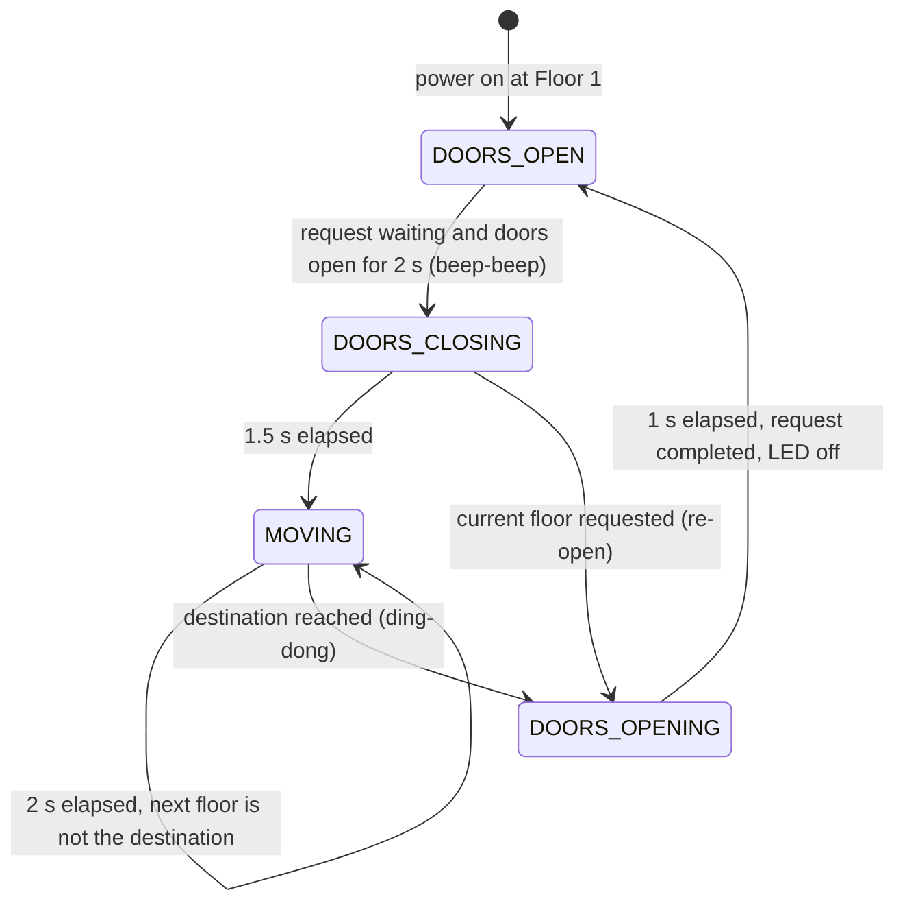

# Homework 6: Three-Floor Elevator Controller

**ESP32 · native ESP-IDF · PlatformIO · C++**

This project is a small working model of an elevator control panel. There is no real motor and no real cabin. LEDs, a buzzer and a one-digit display stand in for them. The **logic** is the same kind an actual elevator controller runs: it listens to buttons, remembers who asked for which floor, closes the doors, travels floor by floor, announces its arrival, and opens the doors again. It keeps doing that indefinitely without blocking or forgetting a request.

If you are new to robotics, this README is written for you. Each idea is explained first in plain words with an everyday comparison, and the technical term comes after that.

---

## Demo video

[](media/elevator_demo.mp4)

> 🎬 **[Watch the demonstration video (media/elevator_demo.mp4, 56 s)](media/elevator_demo.mp4)**

What to look for in the video:

| Time (approx.) | What happens |
|---|---|
| 0:00 – 0:33 | The assembled circuit. Buttons are pressed and the green **request LEDs** light up. The door-closing beeps sound, the yellow **movement LED** blinks while the elevator "travels", the **7-segment display** counts through each floor, and the arrival "ding-dong" plays. Requests are also made while the elevator is already busy, and they are remembered and served afterwards. |
| 0:34 – 0:56 | The **Serial Monitor** with the ESP-IDF logs: requests, queue contents, state changes, floors reached and completed requests. |

---

## Table of contents

1. [The big picture: what are we building?](#1-the-big-picture-what-are-we-building)
2. [Hardware: the parts and why each one is there](#2-hardware-the-parts-and-why-each-one-is-there)
3. [Wiring: schematic, GPIO map and photos](#3-wiring-schematic-gpio-map-and-photos)
4. [Small calculations (resistors and currents)](#4-small-calculations-resistors-and-currents)
5. [Project setup (PlatformIO + ESP-IDF)](#5-project-setup-platformio--esp-idf)
6. [How the software thinks](#6-how-the-software-thinks)
   - 6.1 [The main loop: a juggler, not a sleeper](#61-the-main-loop-a-juggler-not-a-sleeper)
   - 6.2 [The state machine: the elevator's "mood"](#62-the-state-machine-the-elevators-mood)
   - 6.3 [Buttons: debouncing and edge detection](#63-buttons-debouncing-and-edge-detection)
   - 6.4 [The request queue (FIFO)](#64-the-request-queue-fifo)
   - 6.5 [Request LEDs](#65-request-leds)
   - 6.6 [Movement LED (non-blocking blink)](#66-movement-led-non-blocking-blink)
   - 6.7 [Buzzer: playing melodies with LEDC PWM](#67-buzzer-playing-melodies-with-ledc-pwm)
   - 6.8 [7-segment display through a 74HC595 shift register](#68-7-segment-display-through-a-74hc595-shift-register)
   - 6.9 [Logging](#69-logging)
7. [Special situations and how they are handled](#7-special-situations-and-how-they-are-handled)
8. [Requirements checklist](#8-requirements-checklist)
9. [Ideas for improvement](#9-ideas-for-improvement)
10. [Acknowledgements](#10-acknowledgements)

---

## 1. The big picture: what are we building?

Picture a building with three floors and one elevator. Each floor has a call button. People press buttons whenever they like: while the elevator is resting, while its doors are closing, or in the middle of a trip. A good elevator:

- **never forgets** a request, even if it is busy,
- **doesn't double-book**: pressing "3" five times still means one stop at floor 3,
- **shows what is going on**: which floor it is on, which floors are waiting, whether it is moving,
- **makes sounds** so people know the doors are closing or that it has arrived,
- and **reacts instantly**, even halfway through a trip.

Our model does exactly that:

| Real elevator | Our model |
|---|---|
| Call buttons on each floor | 3 push buttons (Floor 1, 2, 3) |
| Lit-up call buttons ("your request is registered") | 3 green LEDs, one per floor |
| Floor indicator above the doors | 1-digit 7-segment display showing 1, 2 or 3 |
| "The cabin is moving" | 1 yellow LED that blinks while moving |
| Door chime / arrival "ding" | Passive buzzer playing two different melodies |
| The motor and doors | Simulated with timers (it just *waits* a realistic amount of time) |
| The controller in the machine room | ESP32 microcontroller |

---

## 2. Hardware: the parts and why each one is there

| Qty | Component | Role in the project |
|---|---|---|
| 1 | ESP32 DevKit | The "brain". It runs our program, reads the buttons and drives everything else. |
| 3 | Push buttons | Floor requests 1, 2, 3 |
| 3 | Green LEDs + 220 Ω resistors | "Request pending" indicators for floors 1, 2, 3 |
| 1 | Yellow LED + 220 Ω resistor | Movement indicator (blinks while moving) |
| 1 | 1-digit 7-segment display (**common cathode**) | Shows the current floor |
| 1 | 74HC595 (SN74HC595) shift register | Drives the 8 display segments using only 3 ESP32 pins (bonus feature) |
| 8 | 1 kΩ resistors | Current limiting for each display segment |
| 1 | Passive buzzer | Door-closing and arrival sounds |
| — | Breadboards, jumper wires | Connections |

**Beginner notes on a few of these parts:**

- **Push button + internal pull-up.** A button is just a gate that connects two wires when pressed. One leg goes to the ESP32 pin and the other goes to GND. Inside the ESP32 we switch on a *pull-up resistor*. Think of it as a weak spring that holds the pin at 3.3 V (logic **1**) when nobody is pressing. Pressing the button connects the pin straight to ground, which overpowers the spring, so the pin reads **0**. That is why the code treats **LOW as "pressed"**, also called *active LOW*. We need no extra resistors on the breadboard.

- **Passive vs. active buzzer.** An *active* buzzer has its own oscillator and beeps at one fixed pitch when you apply voltage. A *passive* buzzer is like a tiny speaker: it only makes sound if *you* wiggle the voltage on and off, and the speed of the wiggling sets the pitch. That is what lets us play different notes, and it is why we need PWM (see [6.7](#67-buzzer-playing-melodies-with-ledc-pwm)).

- **Common-cathode 7-segment display.** The display is 8 small LEDs (segments a–g plus the decimal point) arranged in a figure 8. "Common cathode" means all their negative legs are joined and go to GND. To light a segment you put **HIGH (1)** on its pin. On a *common-anode* display it is the other way round (LOW lights it), so always check which type you have.

- **74HC595 shift register.** This is explained in detail in [6.8](#68-7-segment-display-through-a-74hc595-shift-register). In short, it saves us 5 GPIO pins.

---

## 3. Wiring: schematic, GPIO map and photos

### Circuit schematic


All ground symbols are the common ESP32 GND, and 3.3 V is the ESP32's 3V3 pin (the board is powered over USB).

### GPIO assignments

| ESP32 GPIO | Connected to | Direction | Notes |
|---|---|---|---|
| GPIO 18 | Button 1 (Floor 1) | Input | Internal pull-up, active LOW |
| GPIO 19 | Button 2 (Floor 2) | Input | Internal pull-up, active LOW |
| GPIO 21 | Button 3 (Floor 3) | Input | Internal pull-up, active LOW |
| GPIO 26 | LED 1: Floor 1 request | Output | via 220 Ω |
| GPIO 25 | LED 2: Floor 2 request | Output | via 220 Ω |
| GPIO 33 | LED 3: Floor 3 request | Output | via 220 Ω |
| GPIO 27 | Movement LED (yellow) | Output | via 220 Ω |
| GPIO 17 | Passive buzzer | Output (LEDC PWM) | other leg to GND |
| GPIO 23 | 74HC595 **DS** (pin 14): data | Output | |
| GPIO 22 | 74HC595 **STCP** (pin 12): latch | Output | |
| GPIO 16 | 74HC595 **SHCP** (pin 11): clock | Output | |

**Why these pins?** The ESP32 has a few "picky" pins that a beginner should avoid:

- **GPIO 34–39 are input-only.** They can't drive LEDs, so they would only suit buttons.
- **Strapping pins (GPIO 0, 2, 5, 12, 15)** are read by the chip at power-up to decide how to boot. Connecting a button or LED there can stop the board from starting or uploading.
- **GPIO 6–11** are wired to the on-board flash memory. Never use them.

None of the pins above belong to those groups, so the circuit boots and uploads reliably. (GPIO 16/17 are fine on WROOM-based DevKits. On WROVER modules they are reserved for PSRAM.)

### 74HC595 connections

| 74HC595 pin | Connected to | Meaning |
|---|---|---|
| 16 (VCC) | 3.3 V | power |
| 8 (GND) | GND | ground |
| 10 (MR̅, master reset) | 3.3 V | held HIGH so the chip is never reset |
| 13 (OE̅, output enable) | GND | held LOW so the outputs are always enabled |
| 14 (DS) | GPIO 23 | serial data in |
| 11 (SHCP) | GPIO 16 | shift clock |
| 12 (STCP) | GPIO 22 | latch (storage clock) |
| 9 (Q7′) | not connected | used only for chaining several 595s |
| 7 (Q7) | segment **a** | via 1 kΩ |
| 6 (Q6) | segment **b** | via 1 kΩ |
| 5 (Q5) | segment **c** | via 1 kΩ |
| 4 (Q4) | segment **d** | via 1 kΩ |
| 3 (Q3) | segment **e** | via 1 kΩ |
| 2 (Q2) | segment **f** | via 1 kΩ |
| 1 (Q1) | segment **g** | via 1 kΩ |
| 15 (Q0) | segment **dp** | via 1 kΩ (kept dark) |

The display's common cathode pins go to GND.

### Photos of the assembled circuit

**Top view.** From left to right: the ESP32 (top-left), the three green request LEDs above the three buttons, the yellow movement LED, the buzzer, and the 7-segment display on the right. The 74HC595 and the segment resistors sit on the lower breadboard.


**Side view.** The same circuit running, with the code in VS Code / PlatformIO and the ESP-IDF log output in the terminal behind it.


---

## 4. Timings chosen (all inside the ranges suggested in the assignment):**

| Operation | Constant in code | Value |
|---|---|---|
| Doors stay open (minimum) before leaving | `DOORS_OPEN_MIN_MS` | 2000 ms |
| Doors closing | `DOOR_CLOSING_MS` | 1500 ms |
| Travel between two adjacent floors | `FLOOR_TRAVEL_MS` | 2000 ms |
| Doors opening after arrival | `DOOR_OPENING_MS` | 1000 ms |
| Movement LED half-period | `MOVING_BLINK_MS` | 250 ms (blinks 2× per second) |
| Button debounce time | `DEBOUNCE_MS` | 50 ms |
| Main loop period | `LOOP_PERIOD_MS` | 10 ms |

So a trip from floor 1 to floor 3 takes 1.5 s (closing) + 2 × 2 s (two floor legs) + 1 s (opening) = **6.5 s**.

---

## 5. Project setup (PlatformIO + ESP-IDF)

This homework uses **native ESP-IDF** (Espressif's own framework) instead of Arduino. Arduino hides a lot behind `digitalWrite()` and `delay()`. ESP-IDF is closer to the hardware: we configure GPIOs with `gpio_config()`, generate tones with the `LEDC` driver, log with `ESP_LOGx()` and run on top of **FreeRTOS**, a small real-time operating system.

Steps after creating a PlatformIO project with the ESP-IDF framework:

1. Rename `src/main.c` to **`src/main.cpp`** (we use C++ features such as structs with references and `enum` types).
2. Edit `src/CMakeLists.txt` so the build includes our file and the GPIO and LEDC drivers:

```cmake
idf_component_register(
    SRCS "main.cpp"
    INCLUDE_DIRS "."
    PRIV_REQUIRES
        esp_driver_gpio
        esp_driver_ledc
    )
```

3. Because it's C++, the entry point must be declared `extern "C"` so ESP-IDF can find it:

```cpp
extern "C" void app_main(void) { ... }
```

4. Build, upload, and open the Serial Monitor from PlatformIO to see the logs.

Project layout:

```
Homework 6/
├── platformio.ini        # board + framework (espidf) configuration
├── CMakeLists.txt        # top-level ESP-IDF project file
├── sdkconfig.*           # ESP-IDF configuration generated by menuconfig
├── src/
│   ├── CMakeLists.txt    # component registration (shown above)
│   └── main.cpp          # the whole elevator program
├── images/               # schematic, photos, video thumbnail
├── media/                # demonstration video
└── README.md             # this file
```

---

## 6. How the software thinks

### 6.1 The main loop: a juggler, not a sleeper

The most important idea in this homework is being **non-blocking**.

Imagine a cook making soup, pasta and toast at the same time. A *blocking* cook would stand in front of the soup for 20 minutes doing nothing else, and meanwhile the pasta boils over. A *non-blocking* cook glances at each pot every few seconds, does whatever that pot needs right now (stir, add salt, take it off the heat), and moves on to the next one. Nothing is ever ignored for long.

Our program is the second cook. The whole `app_main()` ends in this loop:

```cpp
while (true) {
    now = nowMs();
    updateButtons(now);    // any button newly pressed?
    updateElevator(now);   // is it time to change state (doors, moving, ...)?
    updateMovingLed(now);  // is it time to toggle the blink?
    updateSound(now);      // is it time for the next note?
    vTaskDelay(loopDelay); // rest 10 ms, let FreeRTOS run other things
}
```

Every 10 ms, each `update...()` function takes a quick look and returns immediately. **None of them ever waits.** Instead of "sleep 2 seconds while the elevator moves", each part remembers **when it started** and compares that with the current time:

```cpp
uint32_t elapsed = now - elevator.stateStartMs;
if (elapsed >= FLOOR_TRAVEL_MS) { /* we've reached the next floor */ }
```

The technical name for this pattern is **elapsed-time checks**, the ESP-IDF equivalent of Arduino's `millis()` technique. Because the loop never gets stuck, a Floor 2 button press in the middle of a 1 → 3 trip is noticed within about 10 ms.

Two small details worth understanding:

- `nowMs()` reads `esp_timer_get_time()` (microseconds since boot) and divides by 1000. It is stored in a `uint32_t`, which rolls over after about 49 days, but `now - start` with **unsigned** numbers still gives the right answer across the rollover. That is why we always subtract instead of comparing `now > start + duration`.
- `vTaskDelay(10 ms)` is a *short* pause that hands the CPU back to FreeRTOS. Without it, our loop would hog the processor and the **watchdog** (a safety timer that resets a frozen chip) would complain. If the tick rate makes 10 ms round down to 0 ticks, the code forces at least 1 tick.

### 6.2 The state machine: the elevator's "mood"

At any moment an elevator is doing exactly **one** thing: standing with its doors open, closing its doors, moving, or opening its doors. It can't be "moving" and "doors open" at the same time. A **finite state machine** is just a formal way of writing that down: a list of possible *states* and the *rules* for jumping from one to another.

A traffic light is the classic example: GREEN → YELLOW → RED → GREEN, each after a certain time. Our elevator works the same way, except that some jumps also depend on button presses.



The states are an `enum`:

```cpp
enum ElevatorState {
    STATE_DOORS_OPEN,
    STATE_DOORS_CLOSING,
    STATE_MOVING,
    STATE_DOORS_OPENING,   // arriving: arrival sound + doors opening
};
```

and everything about the elevator lives in one struct:

```cpp
struct Elevator {
    ElevatorState state;
    int currentFloor;
    int destinationFloor;
    int direction;          // +1 up, -1 down, 0 stopped
    uint32_t stateStartMs;  // when we entered the current state (or floor leg)
};
```

What each state does inside `updateElevator()`:

| State | What it means | What makes it leave |
|---|---|---|
| **DOORS_OPEN** | Standing still, passengers get in/out. | When there is at least one request **and** the doors have been open for at least 2 s, it takes the **oldest** request from the queue as the destination, works out the direction (up/down), plays the door-closing sound and goes to DOORS_CLOSING. |
| **DOORS_CLOSING** | Doors are closing (simulated 1.5 s). | After 1.5 s it goes to MOVING. If someone presses the button of *this* floor in the meantime, it re-opens instead, just like putting your hand in a real elevator door. |
| **MOVING** | Travelling, **one floor at a time**. | Every 2 s it adds `direction` to `currentFloor` and updates the display, so 1 → 3 really shows 1 → 2 → 3. If the new floor is the destination it plays the arrival chime and goes to DOORS_OPENING. Otherwise it restarts the 2 s timer for the next leg. |
| **DOORS_OPENING** | Arrived; doors are opening (1 s). | After 1 s the request for this floor is marked **completed** (its LED goes off) and it returns to DOORS_OPEN. |

All transitions go through one helper, `setState()`, which records the new state and its start time and writes a log line. That way no transition can be forgotten in the logs:

```cpp
static void setState(ElevatorState newState, uint32_t now) {
    elevator.state = newState;
    elevator.stateStartMs = now;
    ESP_LOGI(TAG, "State: %s", stateName(newState));
    if (newState == STATE_MOVING) { /* start blinking immediately */ }
}
```

### 6.3 Buttons: debouncing and edge detection

**The problem.** A push button is two small pieces of metal hitting each other. When they touch, they bounce apart and together a few times within a few milliseconds, like a ball dropped on the floor. The ESP32 is fast enough to see every bounce, so one press could look like *five* presses.

**Debouncing** means: "I believe the button's new position only after it has stayed the same for a while." We use 50 ms. Bounces are shorter than that, but a human press is much longer.

**Edge detection** means: "I react to the *moment* the button goes from released to pressed, not to the fact that it *is* pressed." Holding the button for 10 seconds is still only one request.

Each button keeps three pieces of memory:

```cpp
struct Button {
    bool lastRawPressed;   // what the pin said last time we looked (may be bouncing)
    bool stablePressed;    // the "official", debounced state
    uint32_t lastChangeMs; // when the raw reading last changed
};
```

and `updateButtons()` does this for each of the three buttons:

1. Read the pin (`LOW` = pressed).
2. If the raw reading **changed** since last time, the contact may be bouncing, so restart the 50 ms timer and stop here.
3. If the raw reading has been **stable for ≥ 50 ms** and differs from the official state, update the official state.
4. Only if that new official state is **pressed** (the *falling edge* of the pin) call `handleFloorRequest(floor)`.

A release also passes through step 3, but it does nothing. As a bonus, `initButtons()` reads all buttons at boot and treats their current position as the starting state, so **a button held down while powering on does not count as a press**.

### 6.4 The request queue (FIFO)

Think of the queue at a bakery: whoever came first is served first. That is called **FIFO** (*First In, First Out*). Our elevator keeps a small list of floors waiting to be visited, in the order they were requested.

```cpp
static int  requestQueue[NUM_FLOORS];          // e.g. [3, 2]
static int  requestCount = 0;                  // how many entries are used
static bool floorPending[NUM_FLOORS + 1];      // quick "is floor X already waiting?" lookup
```

- **Adding (`enqueueRequest`)**: put the floor at the end, mark it pending, turn its LED on.
- **Choosing the next destination**: always `requestQueue[0]`, the oldest request.
- **Removing (`removeRequest`)**: when a floor is served, find it, shift everything after it one place left, clear its pending flag and turn its LED off.

**No duplicates.** Before adding, we check `floorPending[floor]`. If the floor is already waiting, the press is ignored with a warning. That is why the queue never needs more than 3 slots (there are only 3 different floors). A "queue full" guard exists anyway, as defensive programming.

**The example from the assignment, step by step:**

| Moment | Event | Queue | Display |
|---|---|---|---|
| start | at Floor 1, doors open | `[]` | 1 |
| | Floor 3 pressed | `[3]` | 1 |
| +2 s | doors close (beep-beep) | `[3]` | 1 |
| | moving up… Floor 2 pressed meanwhile | `[3, 2]` | 1 → 2 |
| | FIFO, so it passes floor 2 and goes on to 3 | `[3, 2]` | 3 |
| | arrives at 3 (ding-dong), doors open, LED 3 off | `[2]` | 3 |
| +2 s | doors close, moves **down** to 2 | `[2]` | 3 → 2 |
| | arrives at 2, LED 2 off | `[]` | 2 |

Nothing is lost and every accepted request is eventually served. (A smarter scheduler would stop at 2 on the way up. See [Ideas for improvement](#9-ideas-for-improvement).)

### 6.5 Request LEDs

The green LEDs mean **"this floor is waiting to be served"**. They do *not* show where the elevator is (the display does that). The LED code is tied to the queue, so the two can never disagree:

- `enqueueRequest()` turns the LED **on**.
- `removeRequest()` turns the LED **off**.
- A request is removed only in **DOORS_OPENING, once the doors have finished opening**. So the LED stays lit while the request is waiting *and* while it is being served, and goes dark exactly when "the passenger can step in".

When the queue is empty, all three LEDs are off.

### 6.6 Movement LED (non-blocking blink)

The yellow LED blinks only in the MOVING state. The method is the "cook glancing at the pot" method again: remember when we last toggled, and toggle again once 250 ms have passed.

```cpp
if (elevator.state != STATE_MOVING) { /* make sure it's OFF */ return; }
if (now - movingLedLastToggleMs >= MOVING_BLINK_MS) {
    movingLedLastToggleMs = now;
    setMovingLed(!movingLedOn);
}
```

It has its own timer, separate from the elevator's timers, so it blinks evenly while buttons are pressed, floors change and the buzzer plays. When MOVING starts, `setState()` switches the LED on immediately so the blink begins without delay. Once the state is anything else, the LED is forced off.

### 6.7 Buzzer: playing melodies with LEDC PWM

**What PWM is.** PWM (*Pulse Width Modulation*) means switching a pin on and off very quickly. Two numbers describe it:

- **Frequency**: how many on/off cycles per second. For a passive buzzer, *that is the pitch you hear*. 880 cycles per second is the note A5.
- **Duty cycle**: what fraction of each cycle the pin is ON. 50 % gives a loud, clean square wave, and 0 % is silence.

The ESP32 has a dedicated hardware block for this called **LEDC** (originally made for dimming LEDs). Once configured, it keeps toggling the pin **by itself**, without the CPU. Our code only tells it "play this frequency now" or "be quiet now":

```cpp
ledc_set_freq(..., frequencyHz);           // choose the pitch
ledc_set_duty(..., BUZZER_DUTY_ON);        // 512 of 1024 = 50 % → sound
ledc_update_duty(...);
```

**Melodies as data.** A sound is a short list of notes (frequency + duration), where frequency `0` means a pause:

```cpp
static const Note DOOR_CLOSING_SOUND[] = {      // "beep-beep" – doors closing
    {880, 120}, {0, 80}, {880, 120},
};
static const Note ARRIVAL_SOUND[] = {           // "ding-dong" – arrived
    {1319, 250}, {0, 40}, {1047, 400},          // E6 then C6, a falling chime
};
```

The two sounds are easy to tell apart: two short equal beeps versus a longer, two-tone falling chime.

**Non-blocking playback.** `playSound()` starts the first note and records the time. Then `updateSound()` (called every loop) checks whether the current note's duration has passed. If it has, it moves to the next note, and after the last note it silences the buzzer. A melody therefore plays *in parallel* with everything else, like a music box someone winds up and then leaves alone.

### 6.8 7-segment display through a 74HC595 shift register

**Why use a shift register at all?** The display needs 8 control wires (segments a–g + dp). Driving them straight from the ESP32 would use 8 GPIO pins. A 74HC595 lets us use only **3** pins.

**The analogy: a bucket brigade plus a shop window.** The chip has two rows of 8 boxes:

1. A **shift row** (hidden in the back room). We push in one bit at a time on the **DS** (data) wire. Each pulse on the **SHCP** (clock) wire makes every bit step one box further along, like people passing buckets down a line.
2. A **storage row** (the shop window, connected to the output pins Q0–Q7). When all 8 bits are in place, one pulse on **STCP** (latch) copies the whole back row into the window at once.

Thanks to the latch, the display never shows the half-shifted garbage in between. It jumps cleanly from one digit to the next.

```cpp
static void shiftOutByte(uint8_t value) {
    gpio_set_level(PIN_SR_LATCH, 0);
    for (int bit = 7; bit >= 0; --bit) {               // MSB first
        gpio_set_level(PIN_SR_DATA, (value >> bit) & 0x01);
        gpio_set_level(PIN_SR_CLOCK, 1);               // one "step" of the brigade
        gpio_set_level(PIN_SR_CLOCK, 0);
    }
    gpio_set_level(PIN_SR_LATCH, 1);                   // show it in the window
    gpio_set_level(PIN_SR_LATCH, 0);
}
```

Because we send the **most significant bit first**, after 8 clock pulses bit 7 has travelled all the way to **Q7** and bit 0 sits in **Q0**.

**Bit-to-segment mapping.** We wired Q7 → a, Q6 → b … Q1 → g, Q0 → dp, so each segment is one bit of a byte:

| Bit | 7 | 6 | 5 | 4 | 3 | 2 | 1 | 0 |
|---|---|---|---|---|---|---|---|---|
| Output | Q7 | Q6 | Q5 | Q4 | Q3 | Q2 | Q1 | Q0 |
| Segment | **a** | **b** | **c** | **d** | **e** | **f** | **g** | dp |

```
      a
    -----
 f |     | b
   |  g  |
    -----
 e |     | c
   |     |
    -----   . dp
      d
```

Digits are built by **OR-ing** the segments together (bitwise operations from the labs):

| Digit | Segments lit | Binary (a…dp) | Hex |
|---|---|---|---|
| 1 | b, c | `0110 0000` | `0x60` |
| 2 | a, b, d, e, g | `1101 1010` | `0xDA` |
| 3 | a, b, c, d, g | `1111 0010` | `0xF2` |

```cpp
SEG_B | SEG_C                          // 1
SEG_A | SEG_B | SEG_D | SEG_E | SEG_G  // 2
SEG_A | SEG_B | SEG_C | SEG_D | SEG_G  // 3
```

`showFloor()` also clears the DP bit with `& ~SEG_DP` and blanks the display (`0x00`) for an invalid floor. Since the display is common cathode, a **1** bit lights a segment.

The display is updated only **when the floor changes** (at boot and each time a floor is reached). The 74HC595 latch then holds the image by itself, so we don't have to refresh it all the time.

### 6.9 Logging

ESP-IDF's logging macros print a level letter, a timestamp in ms since boot, and a **tag** (we use `"ELEVATOR"`):

- `ESP_LOGI`: **I**nfo, normal events
- `ESP_LOGW`: **W**arning, unusual but handled (duplicates, "already here", re-opening doors)
- `ESP_LOGE`: **E**rror, something went wrong (queue full; should never happen)

Logs are **event-driven**. A line is printed only when something *changes*, never on every pass of the loop, so the monitor stays readable. A typical trip with a request made while moving looks like this:

```
I (...) ELEVATOR: Initialized at Floor 1
I (...) ELEVATOR: State: DOORS_OPEN
I (...) ELEVATOR: Requests: []
I (...) ELEVATOR: Floor 3 requested
I (...) ELEVATOR: Requests: [3]
I (...) ELEVATOR: Destination: Floor 3
I (...) ELEVATOR: State: DOORS_CLOSING
I (...) ELEVATOR: State: MOVING
I (...) ELEVATOR: Moving up from Floor 1
I (...) ELEVATOR: Floor 2 requested          <- pressed while moving
I (...) ELEVATOR: Requests: [3, 2]           <- remembered, not lost
I (...) ELEVATOR: Reached Floor 2
I (...) ELEVATOR: Reached Floor 3
I (...) ELEVATOR: Arrived at Floor 3
I (...) ELEVATOR: State: DOORS_OPENING
I (...) ELEVATOR: Request for Floor 3 completed
I (...) ELEVATOR: Requests: [2]
I (...) ELEVATOR: State: DOORS_OPEN
W (...) ELEVATOR: Floor 2 is already pending - duplicate ignored
```

| Required log item | Where it comes from |
|---|---|
| Initialization + starting floor | `app_main()` → "Initialized at Floor 1" |
| New floor requests | `handleFloorRequest()` → "Floor X requested" |
| Duplicate / ignored requests | `ESP_LOGW` → "already pending", "already at Floor X", "doors are already opening" |
| Queue whenever it changes | `logQueue()` after every add/remove → "Requests: [...]" |
| Selected destination | DOORS_OPEN → "Destination: Floor X" |
| State transitions | `setState()` → "State: ..." |
| Movement between floors | "Moving up/down from Floor X", "Reached Floor X" |
| Arrival | "Arrived at Floor X" |
| Completed requests | "Request for Floor X completed" |

---

## 7. Special situations and how they are handled

Good embedded code is judged by what happens in the awkward cases, not only the happy path:

| Situation | Behaviour |
|---|---|
| Press the floor you are on while doors are **open** | Request is considered already satisfied (warning logged). The door timer restarts, so the doors stay open a little longer, like pressing "open door". |
| Press the floor you are on while doors are **opening** | Already satisfied (warning logged). Nothing is queued. |
| Press the floor you are on while doors are **closing** | Request is queued and the doors **re-open** (warning logged). The LED turns off once they are open again. Then the elevator continues to its original destination. |
| Press a floor that is **already pending** | Ignored as a duplicate (warning logged). There are no double stops. |
| Hold a button down | Only one request (edge detection). |
| Contact bounce | Filtered out by the 50 ms debounce. |
| Button held while powering on | Not treated as a press. |
| Request during MOVING / DOORS_CLOSING / DOORS_OPENING | Accepted and queued immediately, because the loop never blocks. |
| Many consecutive trips | Works indefinitely, with no reset or re-upload needed. |

---

## 8. Requirements checklist

| # | Requirement | Status | Where in the code |
|---|---|---|---|
| 1 | Starts at Floor 1, doors open; display shows current floor and passes through every floor | ✅ | `app_main()`, `showFloor()`, MOVING state |
| 2 | Three debounced buttons with edge detection, no repeats on hold, requests accepted in every state | ✅ | `updateButtons()`, `handleFloorRequest()` |
| 3 | State machine: DOORS_OPEN → DOORS_CLOSING → MOVING → DOORS_OPENING | ✅ | `ElevatorState`, `updateElevator()`, `setState()` |
| 4 | Request LEDs on while pending/servicing, off when doors open at that floor | ✅ | `enqueueRequest()`, `removeRequest()` |
| 5 | Movement LED blinks only while moving, independently | ✅ | `updateMovingLed()` |
| 6 | Two distinct buzzer sounds via LEDC, non-blocking | ✅ | `initBuzzer()`, `playSound()`, `updateSound()` |
| 7 | FIFO request queue, no lost requests, no duplicates | ✅ | `requestQueue`, `floorPending` |
| 8 | Fully non-blocking (elapsed-time checks + short `vTaskDelay`) | ✅ | main loop |
| 9 | ESP-IDF logging of all required events, event-driven | ✅ | `ESP_LOGI/W/E` calls |
| 10 | Native ESP-IDF drivers (GPIO, LEDC, esp_timer, log), structured functions | ✅ | whole `main.cpp` |
| 11 | Video demonstration | ✅ | [media/elevator_demo.mp4](media/elevator_demo.mp4) |
| Bonus | **74HC595 shift register** for the display, with bit mapping explained | ✅ | `shiftOutByte()`, section [6.8](#68-7-segment-display-through-a-74hc595-shift-register) |
| Extra | Doors re-open if the current floor is requested while closing | ✅ | `handleFloorRequest()` |

---

## 9. Conclusion

The elevator simulation successfully implements a responsive, non-blocking state machine using
ESP-IDF. It correctly manages floor requests with debounced buttons, a FIFO queue, LED indicators 
movement and door sounds, 7-segment display output, and robust handling of edge cases. The project 
demonstrates practical embedded systems concepts, including state machines, timers, peripheral 
drivers, shift-register control, and event logging.

