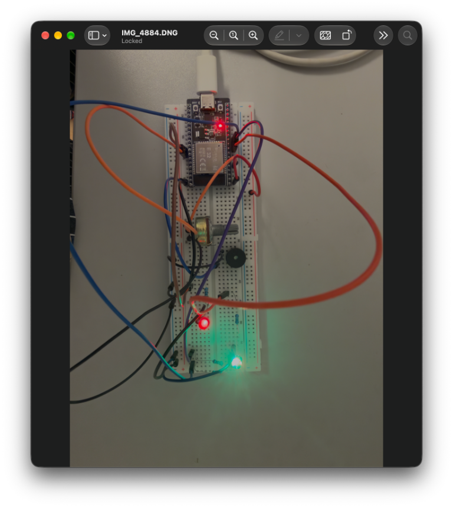

# Introduction To Robotics (2026-2027)

Meylis Hudayberdiyev's repository for presenting homework from the "Intro to Robotics" course taken in  3rd year in 2026-2027. Each homework will have a detailed description in the following sections.
__________________________________________________________________________________________________________

## Homework #1

For this homework I had to complete a formular via this link https://forms.gle/35oZKw9QovH9uM5U7. This homework was assigned and successfully submitted through Microsoft Teams on Wednesday 7th of October, 2026 at 20:43. I, personally, did not have any problems completing this formular. Through this homework I got my group where I will continue my studies in "Introduction to Robotics" subject.
__________________________________________________________________________________________________________

## Homework #2

For this homework I had to learn how to work with the Falstad Circuit Simulator and strengthen my knowledge of fundamental electrical components, Ohm’s Law, Kirchhoff’s Voltage Law (KVL), and Kirchhoff’s Current Law (KCL) by creating and analyzing circuits, calculating electrical values, and confirming my theoretical results through simulations.

### First Exercise (Series Circuit)

To complete this exercise I had to create a circuit with a direct current voltage source of 5 V and at least two resistors and one LED in series. Afterwards I had to choose resistor values to get a current of 5-20 mA through LED. And finally I had to calculate the current, voltage drops and power dissipated by each resistor and to verify KVL.

### Solution

I started with direct current voltage source with 5 V then connected through wires two resistors and one LED in series. I selected two 150 ohm resistors connected in series. 

Their total resistance is 300 ohms. Assuming the LED has a forward voltage of 2 V, the voltage across the resistors is 5 minus 2, which equals 3 V. Using Ohm’s law **( V = I * R )**, the current is 3 divided by 300, giving **10 mA**. That is how I got the current value.

To determine the allowable resistance range, I used the maximum current of 20 milliamperes to calculate a minimum resistance of 150 ohms, and the minimum current of 5 milliamperes to calculate a maximum resistance of 600 ohms. Therefore, the total resistance must be between 150 and 600 ohms under these assumptions or from 75 to 300 ohms each.

Since both resistors have the same resistance and are connected in series, they share the 3 V equally. So, for the first and second resistors we get VR1=VR2=0.01*150=**1.5 V** of voltage drops.

To calculate the power dissipated by each resistor I used **Joule's Law of Heating**. Power tells us how much electrical energy each resistor converts into heat per second. So, with this formula: **P=I^2*R** we get: PR1=PR2= (0.01)^2 * 150 = 0.015 W or 15 mW.

Kirchhoff's Voltage Law states:

_The sum of all voltage rises and drops around a closed loop equals zero._

For our circuit:

Vsource-VR1-VR2-VLED=0

5 - 1.5 - 1.5 - 2 = 0 

5 - 5 = 0 V

KVL is verified!

### Pictures and Videos

[Watch the Exercise 1 video](Homework%232/ex1/ex1vid.mov)
__________________________________________________________________________________________________________

### Second Exercise (Parallel Circuit)

To complete this exercise I had to create a circuit with a direct current voltage source of 9 V and at least two parallel branches, each containing resistor and LED. Afterwards I had to choose resistor values to get different currents of 5-20 mA through the LEDs. And finally I had to calculate the currentof each branch, the total current and resistor power dissipation and to verify KCL and KVL.

### Solution

The objective of this experiment is to build and analyze a parallel circuit containing two branches, each consisting of a resistor and an LED connected in series.

The circuit consists of:
- One 9 V DC voltage source.
- One red LED in each branch.
- One 800 Ω resistor in the first branch.
- One 400 Ω resistor in the second branch.

Both branches are connected in parallel across the 9 V supply. Each resistor limits the current flowing through its corresponding LED. Different resistor values produce different branch currents. For the theoretical calculations, the forward voltage of each LED is assumed to be approximately 2 V.

The voltage across each resistor is calculated using:
VR = VS - VLED
Assuming a supply voltage of 9 V and an LED forward voltage of 2 V:
VR = 9 - 2 = 7 V
Therefore, the voltage across each resistor is approximately 7 V.

Now I calculate current on each branch.

Using Ohm's Law:

I1 = VR / R1

I1 = 7 / 800

I1 = 0.00875 A = 8.75 mA

I2 = VR / R2

I2 = 7 / 400

I2 = 0.0175 A = 17.5 mA

Both branch currents are within the required range of 5-20 mA.

Total current:

IT = I1 + I2

IT = 8.75 + 17.5 

IT = 26.25 mA

Next I calculated the power dissipated by each resistor using **Joule's Law of Heating**:

P = I^2 * R

V = I * R => I = V / R

P = (V / R)^2 * R => P = V^2 / R

P1 = 7^2 / 800 = 0.06125 W = 61.25 mW

P2 = 7^2 / 400 = 0.1225 W = 122.5 mW

Both resistors can be implemented using standard 0.25 W resistors.

Kirchhoff's Current Law states that the total current entering a junction equals the total current leaving the junction.
For this circuit:

IT = I1 + I2

IT = 26.25 mA

I1 + I2 = 18.75 + 17.5 = 26.25 mA

Therefore, KCL is satisfied.

Kirchhoff's Voltage Law states that the algebraic sum of the voltages around a closed loop equals zero.
For Branch 1:

VS - VR1 - VLED1 = 0

9 - 7 - 2 = 0

For Branch 2:
VS - VR2 - VLED2 = 0

9 - 7 - 2 = 0

Therefore, KVL is satisfied for both branches under the assumed LED forward voltage.

### Pictures and Videos

[Watch the Exercise 2 video](Homework%232/ex2/ex2vid.mov)
__________________________________________________________________________________________________________

### Third Exercise (RC Circuit)

The objective of this experiment is to build and simulate an RC circuit using Falstad Circuit Simulator and study the charging and discharging behavior of capacitors. The circuit contains a 12 V DC source, a push button, an LED, resistors, and two capacitors. An RC circuit consists of resistors and capacitors. The resistor controls the current flowing through the circuit, while the capacitor stores electrical energy. When the push button is pressed, the capacitors charge from the 12 V DC source through the charging path. When the button is released, the source is disconnected from the charging path. The energy stored in the capacitors can then supply current through the discharge path. As the capacitor voltage decreases, the current through the LED also decreases, causing its brightness to fade. The charging and discharging rates depend on the effective resistance and equivalent capacitance of the circuit.

### Solution

For capacitors connected in series, the equivalent capacitance is calculated using:

1/Ceq = 1/C1 + 1/C2

For two capacitors, this becomes:

Ceq = (C1 × C2) / (C1 + C2)

Given:

C1 = C2 = 1 mF = 0.001 F

Substituting:

Ceq = (0.001 × 0.001) / (0.001 + 0.001)

Ceq = 0.0005 F

Therefore:

Ceq = 500 µF = 0.5 mF

Connecting capacitors in series reduces the equivalent capacitance. For two identical capacitors, the equivalent capacitance is half the value of either capacitor.

For capacitors connected in parallel, the equivalent capacitance is the sum of their capacitances:

Ceq = C1 + C2

Given:

C1 = C2 = 1 mF

Substituting:

Ceq = 1 mF + 1 mF

Therefore:

Ceq = 2 mF = 2000 µF = 0.002 F

Connecting capacitors in parallel increases the equivalent capacitance. For two identical capacitors, the equivalent capacitance is twice the value of either capacitor.

The RC time constant describes how quickly the capacitor voltage changes during charging and discharging.

The formula is:

τ = R × Ceq

Where:

- τ is the time constant in seconds.
- R is the effective resistance in ohms.
- Ceq is the equivalent capacitance in farads.

For the initial theoretical comparison, an effective resistance of 1 kΩ is assumed.

Series Configuration

Equivalent capacitance:

Ceq = 0.0005 F

Time constant:

τ = 1000 × 0.0005

τ = 0.5 seconds

Parallel Configuration

Equivalent capacitance:

Ceq = 0.002 F

Time constant:

τ = 1000 × 0.002

τ = 2 seconds

The parallel configuration has four times the equivalent capacitance and four times the time constant of the series configuration, assuming the effective resistance is the same. In an ideal first-order RC circuit, approximately 63.2% of the total charging voltage change occurs after one time constant. After five time constants, the capacitor is approximately 99.3% charged or discharged. The actual time constant depends on the resistance seen by the capacitor bank. The LED and the 220 Ω resistor may affect the discharge behavior, so the assumed 1 kΩ resistance must be verified against the actual circuit topology.

The capacitor voltage during charging is described by:

Vc(t) = Vs × (1 - e^(-t/τ))

Where:

- Vc(t) is the capacitor voltage at time t.
- Vs is the supply voltage.
- τ is the RC time constant.
- t is the elapsed time.
- e is the exponential constant.

For this experiment:

Vs = 12 V

The capacitor initially has a voltage of 0 V and gradually approaches the supply voltage of 12 V. As charging progresses, the capacitor voltage increases and the charging current decreases.
The capacitor voltage during discharging is described by:

Vc(t) = V0 × e^(-t/τ)

Where:

- Vc(t) is the capacitor voltage at time t.
- V0 is the initial capacitor voltage at the start of discharging.
- τ is the RC time constant.
- t is the elapsed time.

For this experiment, the initial voltage is assumed to be 12 V. After the push button is released, the capacitor voltage decreases over time. The discharge current also decreases, causing the LED to become dimmer. The exact LED fading behavior depends on the discharge path and the LED’s electrical characteristics.

The selected capacitor voltage threshold is 6 V.

For charging:

- Initial voltage: 0 V
- Supply voltage: 12 V
- Target voltage: 6 V

For discharging:

- Initial voltage: 12 V
- Target voltage: 6 V

Charging Time

The charging equation is:

Vc(t) = Vs × (1 - e^(-t/τ))

Rearranging to calculate time:

t = -τ × ln(1 - Vc/Vs)

Substituting the chosen voltages:

t = -τ × ln(1 - 6/12)

t = -τ × ln(0.5)

Therefore:

t = 0.693 × τ

For the series configuration:

t = 0.693 × 0.5

t ≈ 0.347 seconds

For the parallel configuration:

t = 0.693 × 2

t ≈ 1.386 seconds

Discharging Time

The discharging equation is:

Vc(t) = V0 × e^(-t/τ)

Rearranging:

t = -τ × ln(Vc/V0)

Substituting the chosen voltages:

t = -τ × ln(6/12)

Therefore:

t = 0.693 × τ

For the series configuration:

t = 0.693 × 0.5

t ≈ 0.347 seconds

For the parallel configuration:

t = 0.693 × 2

t ≈ 1.386 seconds

### Pictures and Videos

[Watch the Exercise 3 video](Homework%232/ex3/ex3vidser.mov)

[Watch the Exercise 3 video](Homework%232/ex3/ex3vidparal.mov)

### Conclusion

This homework provided practical experience in designing and analyzing electrical circuits using Falstad Circuit Simulator. The experiments demonstrated the relationships between voltage, current, resistance, and capacitance. They also improved my skills in circuit construction, electrical calculations, and comparing theoretical results with simulation behavior.
_____________________________________________________________________________________________________________________________________________________

## Homework #3

For this homework I had to build a fan control and status panel using an ESP32. The potentiometer sets the requested fan speed, an external LED simulates the fan, an RGB LED displays the operating level, and a buzzer gives a short notification at high speed. The built-in LED also blinks independently to show that the controller is running. The fan is simulated with an LED; no motor is connected.

### Hardware and Connections

The project uses one fixed circuit with these ESP32 GPIO assignments:

| Component | ESP32 GPIO | Connection |
|---|---:|---|
| Built-in LED | GPIO2 | On-board LED |
| Potentiometer | GPIO34 | Center pin to GPIO34; outer pins to 3.3 V and GND |
| Fan indicator LED | GPIO18 | LED in series with a current-limiting resistor |
| RGB LED red channel | GPIO25 | Red leg through a current-limiting resistor |
| RGB LED green channel | GPIO26 | Green leg through a current-limiting resistor |
| RGB LED blue channel | GPIO27 | Blue leg through a current-limiting resistor |
| Passive buzzer | GPIO23 | Buzzer between GPIO23 and GND |

All components share the ESP32 ground. The potentiometer is powered from 3.3 V, not 5 V. Each LED channel has its own current-limiting resistor. The RGB logic in the program assumes a common-cathode LED, with its common pin connected to GND.

### Solution

The potentiometer is read using the ESP32's 12-bit ADC, producing values from 0 to 4095. The requested fan speed is converted to an 8-bit PWM value:

PWM = ADC reading mapped from 0-4095 to 0-255

The PWM value controls the brightness of the external LED on GPIO18. A higher potentiometer reading produces a higher PWM value and a brighter LED, simulating a faster fan.

The ADC range is divided into three operating levels:

- **Low speed (0-1364):** the RGB LED is blue.
- **Medium speed (1365-2729):** the red and green channels turn on together, producing yellow.
- **High speed (2730-4095):** the RGB LED is red.

The buzzer gives a 1000 Hz tone for 700 ms when the potentiometer first enters the high-speed range. A flag prevents it from sounding continuously while the potentiometer remains high. The flag is reset after the reading falls to 2600 or below, so another notification can sound on a later entry into the high-speed range.

The built-in LED toggles every 1000 ms using `millis()`. The main loop does not use `delay()`, so it can keep reading the potentiometer and updating the outputs while the heartbeat and sound notification are handled. Once per second, the Serial Monitor prints the raw ADC value, calculated PWM value, and selected RGB operating level.

### Pictures and Videos

The hardware photo is included above. Add the video demonstration link here after uploading the video.

### Conclusion

This project demonstrates how analog input, PWM output, digital indicators, and timed sound notifications can be combined in one ESP32 program. It also uses non-blocking timing so the heartbeat continues independently while the other inputs and outputs are updated. No optional bonus features were implemented.
_____________________________________________________________________________________________________________________________________________________
